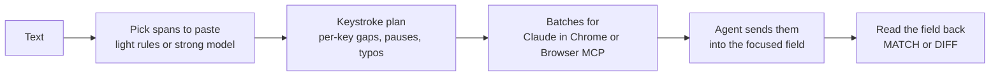

<div align="center">


# human-typing

**Let your AI agent type into Chrome the way you do: uneven keystrokes, typos fixed with Backspace, and code pasted from the editor.**

[Install](#install) · [How it works](#how-it-works) · [Measured results](#measured-results) · [Docs](./docs/README.md) · English | [简体中文](./README.zh-cn.md)

[](#license)
[](https://www.npmjs.com/package/humantype)
[](https://github.com/w21180239/human-typing/actions/workflows/ci.yml)
[](https://github.com/w21180239/human-typing/stargazers)

</div>

Ask Claude to type something into a web page and it usually drops the whole string in at once. human-typing is an agent skill and a small CLI that turns the text into a keystroke plan first: each key gets its own delay, the agent stops to think before some words, makes the odd typo and backspaces over it, and pastes code identifiers the way an engineer copies them from the editor. The plan is sent through [Claude in Chrome](https://claude.com/chrome) or [Browser MCP](https://browsermcp.io) as real key events into your own browser, then checked against the field.

<p align="center">
  
</p>

<table>
<tr>
<td align="center" width="25%"><a href="#measured-results"><b>0.97 / 0.94</b><br/><sub>precision / recall choosing what to paste, held-out corpus</sub></a></td>
<td align="center" width="25%"><a href="#typing-model"><b>~60 WPM</b><br/><sub>default speed, set from a 136M-keystroke study</sub></a></td>
<td align="center" width="25%"><a href="#how-it-works"><b>isTrusted</b><br/><sub>real browser key events, not page JS</sub></a></td>
<td align="center" width="25%"><a href="#install"><b>0</b><br/><sub>dependencies: one Node script</sub></a></td>
</tr>
</table>

## Why

Screen recordings, live demos and pair sessions stop showing a whole message appear in one frame; the text builds up at a person's pace.

Controlled inputs accept it. React and other frameworks often ignore values set from page JavaScript, but these are keyboard events the browser marks as trusted, so `onChange`, autocomplete and character counters fire as they would for you.

Code arrives intact. Identifiers, paths, URLs, hashes and error messages are pasted with Ctrl+V, so they are never mistyped, and they show up as paste events, the same as when you copy from your editor.

You can also point it at your own app to see what its typing analytics or anti-automation checks record for keystroke timing, paste events and corrections.

## Install

```text
# Claude Code (plugin marketplace)
/plugin marketplace add w21180239/human-typing
/plugin install human-typing@human-typing
```

```bash
# Claude Code, Codex, Cursor, Gemini CLI, OpenCode and other agents that read skills
npx skills add w21180239/human-typing

# the CLI on its own (Node 18 or later)
npm install -g humantype
```

The agent also needs a browser tool: the [Claude in Chrome](https://claude.com/chrome) extension, or [Browser MCP](https://browsermcp.io) connected as an MCP server. Claude in Chrome is preferred when both are present, because its waits land within about 10 ms of the plan.

## Use it

Ask in plain words. The skill triggers on requests like these:

```text
Type this into the comment box like I would: "Can you check why fetch_user_profile returns null when the cache is cold?"
慢慢输入这段话到搜索框里，模拟手打
Type my reply into the chat slowly, strong mode
```

The agent writes the text to a file, plans it, focuses the field, sends the batches, restores your clipboard and reads the field back. It never presses Enter to submit and never clicks Send; that stays a separate step you approve.

The CLI works without an agent too, for example to inspect a plan:

```bash
humantype spans "Can you check why fetch_user_profile returns null?"   # what would be pasted, and why
humantype plan "Hello there" --target browsermcp --seed 7               # the full plan as JSON
humantype plan "Hello there" --target chrome --tab 1 --timeline         # raw events with per-key gaps
```

## Span modes

Engineers copy identifiers instead of typing them, so the plan pastes some spans. Which ones depends on the mode:

| Mode | How spans are picked | Cost | Use it for |
| --- | --- | --- | --- |
| `light` (default) | Rules: snake_case, camelCase and PascalCase names of 8+ characters, calls, member chains, paths, URLs, hashes, UUIDs, versions, `KEY=value`, long flags, quoted error messages and log lines | No model call | Almost everything |
| `strong` | A small model (Haiku) marks the spans, starting from the rule candidates | One subagent call | Text where judgement matters: an unquoted error message, YAML `key: value` |
| `off` | Nothing is pasted | None | Plain prose, or when every character must be typed |

Light mode keeps typing what people type from memory: `console.log`, `os.path.join`, `useState`, TypeScript, `package.json`, `npm run build`, bare domains, and a name the second time it comes up. `humantype spans "<text>"` prints each candidate with its reason.

## How it works



The planner never touches the browser. It prints tool input that the agent sends unchanged, one batch per call. A paste is a clipboard write and Ctrl+V in the same batch, so nothing you copy in between can slip in. `humantype clip save` and `clip restore` put your own clipboard back afterwards. Page JavaScript runs only for that clipboard write; every keystroke goes through the browser tool's own key events, which the page sees as `isTrusted`.

### Typing model

| Behaviour | Default |
| --- | --- |
| Burst speed | 86 WPM (`--wpm`), about 60 WPM effective after pauses and fixes |
| Faster | common bigrams (th, er, in), doubled letters, short common words |
| Slower | word starts, capitals, digits, symbols; longer after `,` and `.`; 0.5-1.5 s after a line break |
| Thinking pause | 3% of words, 0.5-1.8 s; 2.5x as often before long uncommon words |
| Typos | 2% per letter: neighbour key, swapped pair or doubled letter, noticed 0-2 letters later and backspaced |
| Re-typed word | 1% of words deleted and typed again |
| Paste | 1.5-5 s to switch window and copy, Ctrl+V, 0.3-1 s before typing resumes |
| CJK text | 1-3 character chunks, as an IME commits them |

The defaults model a fluent second-language English typist who types all day. Dhakal et al. (CHI 2018, 136M keystrokes from 168,960 people) measured a mean of 51.6 WPM and Backspace at 6.3% of keypresses, 3.4% for typists above 78 WPM. Over 500 seeds on a 150-character sentence the defaults give 60 WPM effective (p10-p90 55-66) and Backspace at 3.7% of keypresses. Change `--wpm` alone for a slower or faster persona. Details: [docs/en/TYPING-MODEL.md](./docs/en/TYPING-MODEL.md).

## Measured results

**Span picking (light mode).** Two labelled corpora of developer chat messages, scored by `npm run eval`:

| Corpus | Cases | Exact match | Precision | Recall |
| --- | --- | --- | --- | --- |
| `tests/fixtures/spans.json` (written with the rules) | 33 | 33 | 1.00 | 1.00 |
| `tests/fixtures/spans-holdout.json` (written blind by a separate model) | 40 | 38 | 0.97 | 0.94 |

The holdout was labelled without seeing the rules, but two rule fixes (Windows paths with spaces, cutting a log line at ` -- `) came after its misses were known, so read 0.97 / 0.94 as optimistic. The two remaining misses are an unquoted error message and a YAML `replicaCount: 3`, which is what strong mode is for. Before this release's rule work the same holdout scored 0.59 / 0.79.

**Backends.** Measured on a Windows 11 desktop with Chrome stable against the bundled probe page (`humantype serve`):

| | Claude in Chrome | Browser MCP |
| --- | --- | --- |
| Per-action floor | ~18 ms | ~50 ms |
| Wait accuracy vs plan | median +10 ms, max +20 ms (48 gaps) | +10 to +20 ms |
| Backspace | same cost as a letter | blocks ~470 ms, so corrections look slower |
| Events | `isTrusted` keydown, input, paste | `isTrusted` keydown, input, paste |

The planner subtracts each backend's floor from the gaps. Recalibrate on your machine with `humantype serve` and [docs/en/TYPING-MODEL.md](./docs/en/TYPING-MODEL.md#recalibrate).

## How it compares

| | human-typing | `fill` / `form_input` | Puppeteer `type(…, { delay })`, Playwright `pressSequentially` | [Lax3n/HumanTyping](https://github.com/Lax3n/HumanTyping) |
| --- | --- | --- | --- | --- |
| Works from an AI agent in your own Chrome | Yes, skill + Claude in Chrome or Browser MCP | Yes | No, a script drives its own browser | No, a Python library for Playwright and Selenium |
| Uneven per-key timing | Yes | No, instant | No, one fixed delay | Yes, Markov model |
| Typos fixed with Backspace | Yes | No | No | Yes |
| Pastes code like an engineer | Yes, light rules or strong model | No | No | No |
| Restores your clipboard, checks the field | Yes | No | No | No |
| Dependencies | None (Node 18+) | Built in | The framework | Python packages |

Lax3n/HumanTyping is the more detailed typing simulator, with fatigue and a Markov-chain model, and it is the better choice inside a Python Playwright or Selenium script. Pick human-typing when an AI agent is doing the typing in your real browser.

## FAQ

**Does it get past bot detection or CAPTCHAs?** No. It shapes keystroke timing and nothing else: no fingerprint changes, no mouse paths, no CAPTCHA handling. Use it on your own pages and in tools you are allowed to automate.

**Will it submit the form?** No. A plan contains no Enter-to-submit and no click. For text with line breaks you pick `--newline enter` (Enter adds a line) or `--newline shift` (the field submits on Enter, so lines use Shift+Enter); the plan refuses to run without one.

**What happens to my clipboard?** Pasting overwrites it, so the skill saves it with `humantype clip save` first and puts it back with `clip restore`, also when a batch fails.

**How long does it take?** About as long as you would: a 150-character message takes 25-35 seconds at the defaults. With three or more batches the skill hands the sending to a small subagent so the batch JSON stays out of the main context.

**Does strong mode need an API key?** No. In Claude Code it runs as a Haiku subagent on your existing plan. Agents without subagents stay in light mode.

## Documentation

| Topic | Where |
| --- | --- |
| CLI commands, flags and exit codes | [docs/en/CLI.md](./docs/en/CLI.md) |
| Typing model, defaults and recalibration | [docs/en/TYPING-MODEL.md](./docs/en/TYPING-MODEL.md) |
| The skill the agent follows | [plugins/human-typing/skills/human-typing/SKILL.md](./plugins/human-typing/skills/human-typing/SKILL.md) |
| Notes for coding agents working on this repo | [AGENTS.md](./AGENTS.md) |
| Changelog | [docs/en/CHANGELOG.md](./docs/en/CHANGELOG.md) |

## Contributing

Issues and pull requests are welcome; see [CONTRIBUTING.md](./CONTRIBUTING.md). A sentence where light mode pasted the wrong thing, or missed something you would copy, is the most useful report: add it to a corpus in `tests/fixtures/` and run `npm run eval`.

## License

Licensed under either of [Apache License 2.0](./LICENSE-APACHE) or [MIT](./LICENSE-MIT) at your option.

## Credits

Timing ideas (bigram speed-ups, word-boundary slowdowns, delayed typo correction) follow [Lax3n/HumanTyping](https://github.com/Lax3n/HumanTyping) (MIT); the code here is original. Typing statistics come from Dhakal, Feit, Kristensson and Oulasvirta, [Observations on Typing from 136 Million Keystrokes](https://doi.org/10.1145/3173574.3174220), CHI 2018.
