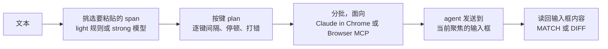

<div align="center">


# human-typing

**让 AI agent 像你一样往 Chrome 里打字：键间节奏不均匀，打错用 Backspace 改，代码从编辑器粘贴。**

[安装](#安装) · [工作原理](#工作原理) · [实测结果](#实测结果) · [文档](./docs/zh-cn/README.md) · [English](./README.md) | 简体中文

[](#许可证)
[](https://www.npmjs.com/package/humantype)
[](https://github.com/w21180239/human-typing/actions/workflows/ci.yml)
[](https://github.com/w21180239/human-typing/stargazers)

</div>

让 Claude 往网页里输入一段文字，它通常会把整串内容一次性塞进去。human-typing 是一个 agent skill 加一个小型 CLI：先把文字变成按键 plan，每个键有各自的延迟，agent 会在某些词前停下来想一想，偶尔打错再用 Backspace 删掉，遇到代码标识符则像工程师从编辑器里复制那样粘贴。plan 通过 [Claude in Chrome](https://claude.com/chrome) 或 [Browser MCP](https://browsermcp.io) 以真实按键事件发送到你自己的浏览器，最后再和输入框的内容对一遍。

<p align="center">
  
</p>

<table>
<tr>
<td align="center" width="25%"><a href="#实测结果"><b>0.97 / 0.94</b><br/><sub>粘贴选择的 precision / recall，held-out 语料</sub></a></td>
<td align="center" width="25%"><a href="#打字模型"><b>~60 WPM</b><br/><sub>默认速度，依据 136M 次按键的研究设定</sub></a></td>
<td align="center" width="25%"><a href="#工作原理"><b>isTrusted</b><br/><sub>真实的浏览器按键事件，不是页面 JS</sub></a></td>
<td align="center" width="25%"><a href="#安装"><b>0</b><br/><sub>依赖：一个 Node 脚本</sub></a></td>
</tr>
</table>

## 为什么需要它

录屏、现场演示和结对编程时，整条消息在一帧里凭空出现并不自然；文字应该按人的节奏一点点出现。

受控输入框也能接受。React 等框架常常忽略由页面 JavaScript 设置的值，而这里发出的是浏览器标记为 trusted 的键盘事件，所以 `onChange`、自动补全和字数统计都会像你亲手输入时一样触发。

代码原样到达。标识符、路径、URL、hash 和报错信息用 Ctrl+V 粘贴，不会打错，在页面看来也是 paste 事件，和你从编辑器里复制过来没有区别。

你也可以把它对准自己的应用，看看应用的打字分析或反自动化检测，会如何记录键间时间、paste 事件和修正操作。

## 安装

```text
# Claude Code (plugin marketplace)
/plugin marketplace add w21180239/human-typing
/plugin install human-typing@human-typing
```

```bash
# Claude Code, Codex, Cursor, Gemini CLI, OpenCode and other agents that read skills
npx skills add w21180239/human-typing

# the CLI on its own (Node 18 or later)
npm install -g humantype
```

agent 还需要一个浏览器工具：[Claude in Chrome](https://claude.com/chrome) 扩展，或作为 MCP server 接入的 [Browser MCP](https://browsermcp.io)。两者都在时优先用 Claude in Chrome，因为它的等待时间与 plan 的偏差在 10 ms 左右。

## 使用

用平常的话提需求即可。下面这类请求会触发 skill：

```text
Type this into the comment box like I would: "Can you check why fetch_user_profile returns null when the cache is cold?"
慢慢输入这段话到搜索框里，模拟手打
Type my reply into the chat slowly, strong mode
```

agent 会把文字写入文件，生成 plan，聚焦输入框，逐批发送，恢复你的剪贴板，再读回输入框的内容。它不会按 Enter 提交，也不会点击 Send；提交是单独一步，由你批准。

不用 agent 也能单独用 CLI，比如查看 plan：

```bash
humantype spans "Can you check why fetch_user_profile returns null?"   # what would be pasted, and why
humantype plan "Hello there" --target browsermcp --seed 7               # the full plan as JSON
humantype plan "Hello there" --target chrome --tab 1 --timeline         # raw events with per-key gaps
```

## Span 模式

工程师会复制标识符而不是逐字敲，所以 plan 会粘贴其中一部分 span。具体粘贴哪些取决于模式：

| 模式 | 如何挑选 span | 成本 | 适用场景 |
| --- | --- | --- | --- |
| `light`（默认） | 规则：8 个字符以上的 snake_case、camelCase 和 PascalCase 名称，函数调用，成员链，路径，URL，hash，UUID，版本号，`KEY=value`，长 flag，带引号的报错信息和日志行 | 不调用模型 | 几乎所有场景 |
| `strong` | 由小模型（Haiku）在规则候选的基础上标出 span | 一次 subagent 调用 | 需要判断的文本：没加引号的报错信息，YAML 的 `key: value` |
| `off` | 什么都不粘贴 | 无 | 纯文字，或每个字符都必须敲出来的场合 |

light 模式照旧手敲人们凭记忆打的内容：`console.log`、`os.path.join`、`useState`、TypeScript、`package.json`、`npm run build`、裸域名，以及第二次出现的同一个名称。`humantype spans "<text>"` 会列出每个候选及其理由。

## 工作原理



planner 从不接触浏览器。它只打印工具输入，由 agent 原样发送，每次调用一批。一次粘贴由剪贴板写入和 Ctrl+V 组成，放在同一批里，所以中间你复制的东西不会混进来。之后用 `humantype clip save` 和 `clip restore` 还原你自己的剪贴板。页面 JavaScript 只用于那一次剪贴板写入；每个按键都走浏览器工具自带的按键事件，页面看到的是 `isTrusted`。

### 打字模型

| 行为 | 默认值 |
| --- | --- |
| 连击速度 | 86 WPM（`--wpm`），计入停顿和修正后约 60 WPM |
| 更快 | 常见 bigram（th、er、in）、连续的重复字母、常见短词 |
| 更慢 | 词首、大写字母、数字、符号；`,` 和 `.` 之后更久；换行后 0.5-1.5 s |
| 思考停顿 | 3% 的词前，0.5-1.8 s；长的生僻词前概率是 2.5 倍 |
| 打错 | 每个字母 2%：相邻键、颠倒的两个字母或重复字母，在 0-2 个字母之后发现并用 Backspace 删掉 |
| 重打单词 | 1% 的词会删掉重打 |
| 粘贴 | 切换窗口并复制 1.5-5 s，Ctrl+V，恢复打字前 0.3-1 s |
| CJK 文本 | 每次 1-3 个字符，和输入法提交的方式一致 |

默认值模拟的是一位整天打字、英语为第二语言但很流利的打字员。Dhakal 等人（CHI 2018，来自 168,960 人的 136M 次按键）测得平均 51.6 WPM，Backspace 占按键的 6.3%，速度超过 78 WPM 的打字员为 3.4%。在 150 个字符的句子上跑 500 个 seed，默认值得到有效速度 60 WPM（p10-p90 为 55-66），Backspace 占按键的 3.7%。想模拟更慢或更快的人，只改 `--wpm` 即可。详情见 [docs/zh-cn/TYPING-MODEL.md](./docs/zh-cn/TYPING-MODEL.md)。

## 实测结果

**Span 挑选（light 模式）。** 两份人工标注的开发者聊天消息语料，由 `npm run eval` 打分：

| 语料 | 用例数 | Exact match | Precision | Recall |
| --- | --- | --- | --- | --- |
| `tests/fixtures/spans.json`（照规则编写） | 33 | 33 | 1.00 | 1.00 |
| `tests/fixtures/spans-holdout.json`（由另一个模型盲写） | 40 | 38 | 0.97 | 0.94 |

holdout 标注时没有看过规则，但有两处规则修正（带空格的 Windows 路径，在 ` -- ` 处截断日志行）是在已知它漏判之后做的，所以 0.97 / 0.94 应当偏乐观地看待。剩下的两处漏判是一条没加引号的报错信息和 YAML 的 `replicaCount: 3`，这正是 strong 模式要处理的。本版本改规则之前，同一份 holdout 的得分是 0.59 / 0.79。

**后端。** 在 Windows 11 桌面、Chrome stable 上，对自带的探测页（`humantype serve`）实测：

| | Claude in Chrome | Browser MCP |
| --- | --- | --- |
| 单次操作的下限 | ~18 ms | ~50 ms |
| 等待相对 plan 的精度 | 中位数 +10 ms，最大 +20 ms（48 个间隔） | +10 到 +20 ms |
| Backspace | 与一个字母的耗时相同 | 阻塞约 470 ms，所以修正看起来更慢 |
| 事件 | `isTrusted` 的 keydown、input、paste | `isTrusted` 的 keydown、input、paste |

planner 会从间隔里减去各后端的下限。要在自己的机器上重新校准，用 `humantype serve` 并参考 [docs/zh-cn/TYPING-MODEL.md](./docs/zh-cn/TYPING-MODEL.md#重新校准)。

## 与其他方案对比

| | human-typing | `fill` / `form_input` | Puppeteer `type(…, { delay })`、Playwright `pressSequentially` | [Lax3n/HumanTyping](https://github.com/Lax3n/HumanTyping) |
| --- | --- | --- | --- | --- |
| 能由 AI agent 在你自己的 Chrome 中使用 | 能，skill + Claude in Chrome 或 Browser MCP | 能 | 不能，脚本驱动自己的浏览器 | 不能，是面向 Playwright 和 Selenium 的 Python 库 |
| 每个键的时间不均匀 | 是 | 否，瞬间完成 | 否，固定一个延迟 | 是，Markov 模型 |
| 打错用 Backspace 改 | 是 | 否 | 否 | 是 |
| 像工程师一样粘贴代码 | 是，light 规则或 strong 模型 | 否 | 否 | 否 |
| 恢复你的剪贴板，核对输入框 | 是 | 否 | 否 | 否 |
| 依赖 | 无（Node 18+） | 内置 | 对应的框架 | Python 包 |

Lax3n/HumanTyping 是更精细的打字模拟器，带疲劳和 Markov 链模型，在 Python 的 Playwright 或 Selenium 脚本里它是更好的选择。当由 AI agent 在你的真实浏览器里打字时，选 human-typing。

## FAQ

**它能绕过机器人检测或 CAPTCHA 吗？** 不能。它只调整按键时间，别的都不碰：不改指纹，不模拟鼠标轨迹，也不处理 CAPTCHA。请只在你自己的页面和你被允许自动化的工具里使用。

**它会提交表单吗？** 不会。plan 里没有 Enter 提交，也没有点击。文本含换行时，你需要选 `--newline enter`（Enter 换行）或 `--newline shift`（输入框按 Enter 就提交，所以换行用 Shift+Enter）；不选的话 plan 会拒绝运行。

**我的剪贴板会怎样？** 粘贴会覆盖它，所以 skill 先用 `humantype clip save` 保存，再用 `clip restore` 放回去，某一批失败时也一样。

**要花多久？** 和你自己差不多：默认值下一条 150 个字符的消息需要 25-35 秒。有三批或更多时，skill 会把发送交给一个小 subagent，让批次 JSON 不进入主上下文。

**strong 模式需要 API key 吗？** 不需要。在 Claude Code 里它作为 Haiku subagent 跑在你现有的套餐上。不支持 subagent 的 agent 只能用 light 模式。

## 文档

| 主题 | 位置 |
| --- | --- |
| CLI 命令、flag 和退出码 | [docs/zh-cn/CLI.md](./docs/zh-cn/CLI.md) |
| 打字模型、默认值和重新校准 | [docs/zh-cn/TYPING-MODEL.md](./docs/zh-cn/TYPING-MODEL.md) |
| agent 遵循的 skill | [plugins/human-typing/skills/human-typing/SKILL.md](./plugins/human-typing/skills/human-typing/SKILL.md) |
| 给在本仓库工作的 coding agent 的说明 | [AGENTS.md](./AGENTS.md) |
| 更新日志 | [docs/zh-cn/CHANGELOG.md](./docs/zh-cn/CHANGELOG.md) |

## 参与贡献

欢迎提 issue 和 pull request，见 [CONTRIBUTING.md](./CONTRIBUTING.md)。最有用的反馈是这样一句话：light 模式粘错了内容，或漏掉了你会复制的东西。把它加进 `tests/fixtures/` 里的某个语料，再运行 `npm run eval`。

## 许可证

可在 [Apache License 2.0](./LICENSE-APACHE) 或 [MIT](./LICENSE-MIT) 中任选其一使用。

## 致谢

时间模型的思路（bigram 加速、词边界减速、延迟纠正打错）参考了 [Lax3n/HumanTyping](https://github.com/Lax3n/HumanTyping)（MIT）；本仓库的代码是原创。打字统计数据来自 Dhakal、Feit、Kristensson 和 Oulasvirta，[Observations on Typing from 136 Million Keystrokes](https://doi.org/10.1145/3173574.3174220)，CHI 2018。
